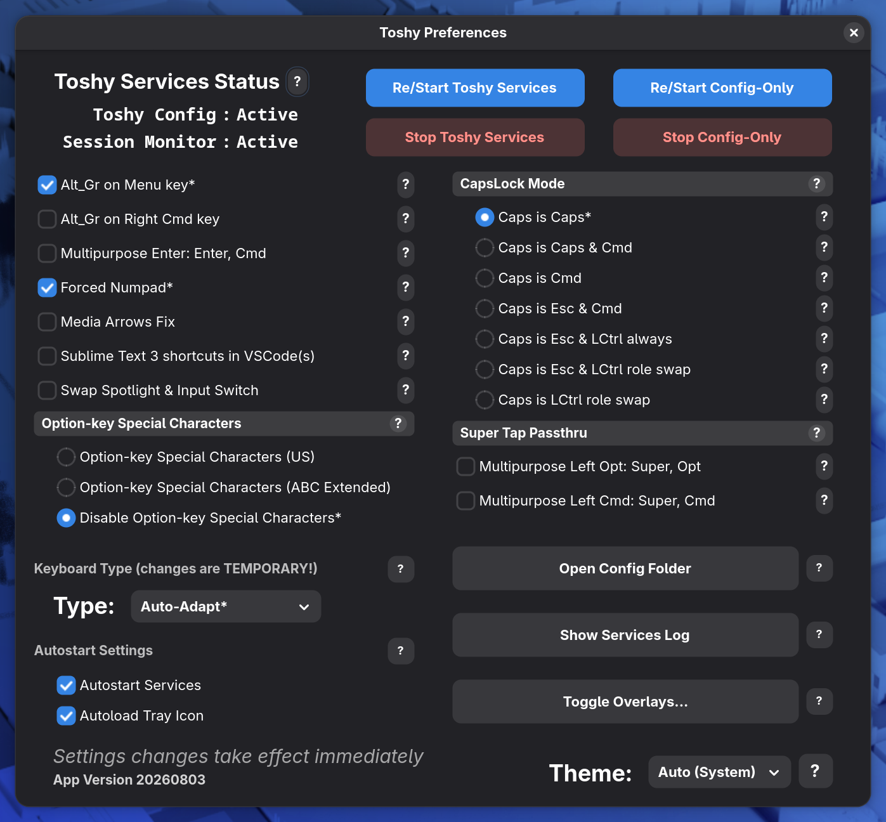
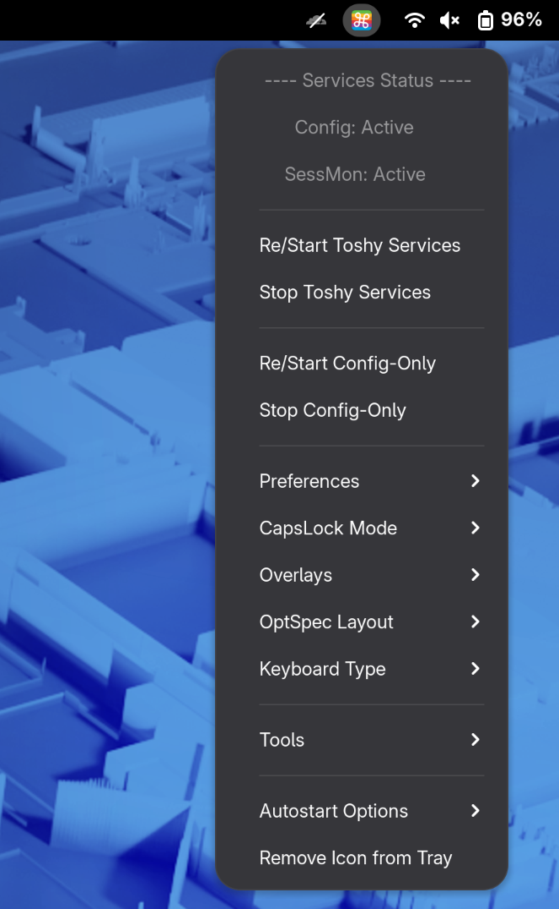
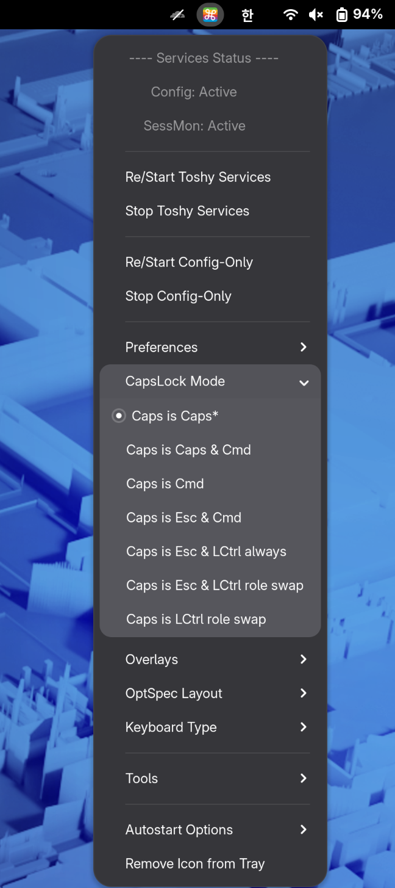
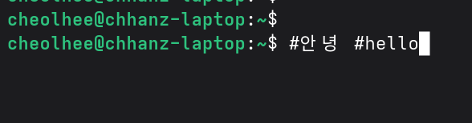

## Asahi Linux에서 macOS 키맵 사용하기 (Toshy + Caps Lock 한/영 전환)


Apple Silicon 맥북에 Asahi Linux(Fedora Asahi Remix)를 설치하고 사용을 해보았습니다.   
설치 자체는 어렵지 않았지만, 가장 먼저 불편했던 것은 키보드였습니다. ⌘C, ⌘V 같은 macOS 단축키와 Caps Lock 한/영 전환이 손에 익어 있다 보니 Linux 기본 키 배치로는 계속 실수를 하게 되었습니다.

Asahi Linux 환경에서 macOS 키맵과 Caps Lock 한/영 전환을 함께 구성한 내용은 기록된 내용이 많지 않아, 해당 포스팅을 작성하게 되었습니다.   
이번 포스팅에서는 Toshy를 이용하여 macOS 키맵을 구성하고, Caps Lock으로 한/영 전환을 하는 방법에 대해 기록하도록 하겠습니다.

### Toshy 란?

[Toshy](https://github.com/RedBearAK/toshy)는 Linux에서 macOS와 같은 키보드 단축키를 사용할 수 있도록 해주는 키 리매퍼 설정입니다. Kinto의 대안으로 시작된 프로젝트이며, xwaykeyz라는 키 리매퍼를 기반으로 동작합니다.

Toshy의 주요 특징은 아래와 같습니다.

- ⌘C, ⌘V, ⌘Tab, ⌥←/→ 등 macOS 단축키 지원
- 터미널에서는 ⌘C/⌘V를 자동으로 Ctrl+Shift+C/V로 변환
- 브라우저, VS Code, 파일 관리자 등 앱별 단축키 보정
- X11과 Wayland(KDE Plasma, GNOME 등) 지원

Toshy 위키의 지원 배포판 목록에도 Fedora Asahi Remix가 사용자 보고 기준으로 등록되어 있습니다.

### 테스트 환경

- 테스트 환경: Fedora Linux Asahi Remix 44 (Workstation Edition)
- Kernel: 7.1.13-402.asahi.fc44.aarch64+16k
- Desktop: GNOME Shell 50.6 (Wayland)
- Toshy: 20260803 (Toshy Preferences의 App Version 기준)
- 입력기: ibus 1.5.34, ibus-hangul 1.5.5

```
$ uname -r
7.1.13-402.asahi.fc44.aarch64+16k

$ gnome-shell --version
GNOME Shell 50.6
```

### Toshy 설치

Toshy는 bootstrap 스크립트를 통해 한 줄로 설치가 가능합니다.

```
$ sh -c "$(curl -L https://raw.githubusercontent.com/RedBearAK/toshy/main/scripts/bootstrap.sh || wget -O - https://raw.githubusercontent.com/RedBearAK/toshy/main/scripts/bootstrap.sh)"
...생략
(EV) Toshy installer sees this environment:
     DISTRO_ID        = 'fedora'
     DISTRO_VER       = '44'
     VARIANT_ID       = 'workstation'
     SESSION_TYPE     = 'wayland'
     DESKTOP_ENV      = 'gnome'
     DE_MAJ_VER       = '50'
     WINDOW_MGR       = 'gnome-shell'
...생략
No compatible shell extensions for GNOME Wayland session support were found...
Install any of the compatible GNOME shell extensions for GNOME Wayland support.
Without this, app-specific keymapping will NOT work in a GNOME Wayland session.
  (See 'Requirements' section in the Toshy README.)

To show that you read the info just above, enter the secret code 'mgby': mgby
```

위와 같이 설치 프로그램이 Fedora 44, GNOME 50, Wayland 환경을 인식한 것을 확인 할 수 있습니다.

> **참고**   
> GNOME Wayland 환경에서는 Shell 확장이 없다는 경고와 함께 `secret code` 입력을 요구합니다.   
> 경고 내용을 읽었다는 확인 절차이며, 화면에 표시된 코드를 대소문자까지 동일하게 입력하면 설치가 계속 진행됩니다.   
> 확장은 Toshy 설치 이후에 추가해도 됩니다.

#### pywayland 빌드 오류

저의 경우 설치 도중 Python 패키지를 설치하는 단계에서 아래와 같이 `pywayland` 빌드 오류가 발생했습니다.

```
  Building wheel for pywayland (pyproject.toml) ... error
  error: subprocess-exited-with-error
...생략
      subprocess.CalledProcessError: Command '['pkg-config', '--variable=pkgdatadir', 'wayland-protocols']' returned non-zero exit status 1.
...생략
      OSError: Unable to find wayland-protocols using pkgconfig
...생략
  ERROR: Failed building wheel for pywayland
Successfully built xkbcommon dbus-python pygobject systemd-python evdev
Failed to build pywayland
(EE) Problem installing/upgrading Python packages. Installer exiting.
```

`pywayland`는 빌드 시 `pkg-config`로 `wayland-protocols` 경로를 찾는데, 해당 개발 패키지가 설치되어 있지 않아 발생한 오류입니다.   
아래와 같이 `wayland-protocols-devel` 패키지를 설치합니다.

```
$ sudo dnf install wayland-protocols-devel wayland-devel
```

패키지 설치 후 bootstrap 스크립트를 다시 실행하면 정상적으로 설치가 완료됩니다.   
설치가 완료되면 로그아웃 후 다시 로그인합니다.

설치가 완료되면 아래와 같이 Toshy Preferences 창에서 서비스 상태를 확인 할 수 있습니다.



### GNOME Shell 확장 설치

GNOME Wayland 환경에서 Toshy가 앱별 단축키를 적용하려면, 현재 포커스된 창 정보를 알려주는 GNOME Shell 확장이 필요합니다.   
이번 테스트에서는 아래 3개의 확장을 사용하였습니다.

| 용도 | 확장 | UUID |
|---|---|---|
| 앱별 키 매핑 | Focused Window D-Bus | `focused-window-dbus@flexagoon.com` |
| 앱별 키 매핑 (예비) | Xremap | `xremap@k0kubun.com` |
| 상단바 트레이 아이콘 | AppIndicator and KStatusNotifierItem Support | `appindicatorsupport@rgcjonas.gmail.com` |

설치 전에 확장을 바로 활성화하려고 하면 아래와 같이 확장이 존재하지 않는다는 메시지가 출력됩니다.

```
$ gnome-extensions enable focused-window-dbus@flexagoon.com
Extension “focused-window-dbus@flexagoon.com” does not exist
```

AppIndicator 확장은 Fedora 패키지로 설치합니다.

```
$ sudo dnf install gnome-shell-extension-appindicator
```

나머지 2개의 확장은 아래와 같은 방법으로 설치합니다.   
`InstallRemoteExtension` D-Bus 메서드를 이용하면 extensions.gnome.org에서 현재 GNOME 버전에 맞는 확장을 받아 설치하며, 다시 로그인하지 않아도 바로 활성화됩니다.

```
$ for uuid in focused-window-dbus@flexagoon.com xremap@k0kubun.com; do
    gdbus call --session \
      --dest org.gnome.Shell.Extensions \
      --object-path /org/gnome/Shell/Extensions \
      --method org.gnome.Shell.Extensions.InstallRemoteExtension \
      "$uuid"
  done
```

명령을 실행하면 확장마다 설치 확인 창이 표시되며, `Install`을 선택합니다.

확장 설치가 완료되면 아래와 같이 상단바에 Toshy 아이콘이 표시되며, 아이콘을 선택하면 서비스 상태(`Config: Active`, `SessMon: Active`)를 확인 할 수 있습니다.



> **참고**   
> 확장 없이도 ⌘C/⌘V 같은 일부 단축키는 동작하기 때문에 설정이 끝난 것처럼 보일 수 있습니다.   
> 앱별 키 매핑까지 정상인지는 터미널에서 ⌘C/⌘V로 복사/붙여넣기가 되는지로 확인 할 수 있습니다.

### Caps Lock 한/영 전환 설정

macOS처럼 Caps Lock으로 한/영 전환을 하기 위해 아래와 같이 구성하였습니다.

- Toshy에서 Caps Lock 키를 `Hangul` 키로 변환
- ibus-hangul이 `Hangul` 키를 받아 한/영 전환

keyd 같은 다른 키 리매퍼를 함께 사용하면 Toshy와 키보드 장치를 서로 점유하려고 하여 충돌할 수 있습니다. 그래서 Caps Lock 변환도 Toshy 설정 안에서 처리하였습니다.

#### ibus-hangul 설정

먼저 ibus-hangul 설치 상태를 확인합니다.

```
$ rpm -q ibus ibus-hangul
ibus-1.5.34-4.fc44.aarch64
ibus-hangul-1.5.5-12.fc44.aarch64
```

설치되어 있지 않다면 `sudo dnf install ibus-hangul`로 설치한 뒤, `설정 → 키보드 → 입력 소스`에서 `Korean (Hangul)`을 추가합니다.

저의 경우 입력 소스를 `Korean (Hangul)` 하나만 사용하였습니다.   
ibus-hangul 엔진은 내부에 영문 모드와 한글 모드를 함께 가지고 있기 때문에, `English (US)` 입력 소스가 따로 있으면 GNOME 입력 소스 전환과 한/영 전환이 겹쳐 헷갈리게 됩니다.

아래와 같이 현재 입력 소스를 확인합니다.

```
$ gsettings get org.gnome.desktop.input-sources sources
[('ibus', 'hangul')]
```

입력 소스가 여러 개라면 설정 화면에서 `English (US)`를 제거하거나, 아래 명령으로 `Korean (Hangul)` 하나만 지정할 수 있습니다.

```
$ gsettings set org.gnome.desktop.input-sources sources "[('ibus', 'hangul')]"
```

ibus-hangul의 한/영 전환키를 확인합니다.

```
$ gsettings get org.freedesktop.ibus.engine.hangul switch-keys
'Hangul,Shift+space'
```

위와 같이 기본값에 `Hangul` 키가 포함되어 있어 별도로 변경할 필요는 없습니다.

#### Toshy 설정

Toshy 설정 파일 `~/.config/toshy/toshy_config.py`를 수정합니다.   
설정 파일에서 `user_custom_modmaps`를 검색하여, 아래 `SLICE_MARK_START`와 `SLICE_MARK_END` 사이에 modmap을 추가합니다.

```python
###  SLICE_MARK_START: user_custom_modmaps  ###  EDITS OUTSIDE THESE MARKS WILL BE LOST ON UPGRADE

modmap("User - CapsLock is Hangul", {
    Key.CAPSLOCK:               Key.HANGEUL,                    # Caps Lock -> 한/영 전환
}, when = lambda ctx: True)

###  SLICE_MARK_END: user_custom_modmaps  ###  EDITS OUTSIDE THESE MARKS WILL BE LOST ON UPGRADE
```

> **주의**   
> 반드시 `SLICE_MARK_START`와 `SLICE_MARK_END` 사이에 작성해야 합니다.   
> Toshy는 업그레이드 시 이 표시 사이의 내용만 새 설정 파일로 옮기며, 표시 밖에 작성한 내용은 사라집니다.

Toshy 트레이 메뉴의 CapsLock 모드는 기본값인 `Caps is Caps`로 유지합니다.   
다른 모드(`Caps is Cmd` 등)를 선택하면 Toshy 내장 CapsLock 매핑이 먼저 적용되어 위 설정이 동작하지 않습니다.

설정을 저장한 후 Toshy 서비스를 재시작합니다.

```
$ toshy-services-restart
```

트레이 메뉴의 `CapsLock Mode`에서 아래와 같이 기본값인 `Caps is Caps*`가 선택되어 있는지 확인합니다.



### 결과 확인

Toshy 서비스 상태를 확인합니다.

```
$ systemctl --user is-active toshy-config.service toshy-session-monitor.service
active
active
```

현재 ibus 엔진을 확인합니다.

```
$ ibus engine
hangul
```

위와 같이 Toshy 서비스가 실행 중이고, ibus 엔진이 `hangul`로 동작하는 것을 확인 할 수 있습니다.

터미널에서 아래와 같이 동작을 확인합니다. 입력한 내용이 명령으로 실행되지 않도록 앞에 `#`을 붙여 입력하였습니다.

1. Caps Lock 입력 후 `dkssud` 입력 시 `안녕` 출력
2. 다시 Caps Lock 입력 후 `hello` 입력 시 영문 그대로 출력



위와 같이 Caps Lock으로 한글과 영문이 전환되는 것을 확인 할 수 있습니다.

### 정리

위와 같은 방법으로 Asahi Linux에서도 macOS와 같은 키맵과 Caps Lock 한/영 전환을 사용하는 것이 가능 합니다. 정리하면 아래와 같은 순서로 진행됩니다.

- bootstrap 스크립트로 Toshy 설치 (`pywayland` 빌드 오류 시 `wayland-protocols-devel` 설치)
- GNOME Wayland 환경은 Focused Window D-Bus 등 Shell 확장 설치
- 입력 소스는 `Korean (Hangul)` 하나만 사용
- Toshy 설정의 `user_custom_modmaps` 영역에 `CAPSLOCK -> HANGEUL` 매핑 추가

Caps Lock을 한/영 전환키로 변경하였기 때문에 Caps Lock 본래의 대문자 고정 기능은 사용할 수 없다는 점과, Toshy의 CapsLock 모드는 기본값으로 유지해야 한다는 점 정도가 처음 구성할 때 확인하면 좋은 부분입니다.

### 참고

- Toshy GitHub: [https://github.com/RedBearAK/toshy](https://github.com/RedBearAK/toshy)
- Toshy 설치 가이드: [https://github.com/RedBearAK/toshy/wiki/How-to-install-Toshy-with-a-single-command](https://github.com/RedBearAK/toshy/wiki/How-to-install-Toshy-with-a-single-command)
- Toshy 지원 배포판: [https://github.com/RedBearAK/toshy/wiki/Supported-Linux-distros](https://github.com/RedBearAK/toshy/wiki/Supported-Linux-distros)
- Toshy FAQ: [https://github.com/RedBearAK/toshy/wiki/FAQ-(Frequently-Asked-Questions)](https://github.com/RedBearAK/toshy/wiki/FAQ-%28Frequently-Asked-Questions%29)
- Fedora Asahi Remix: [https://asahilinux.org/fedora/](https://asahilinux.org/fedora/)
