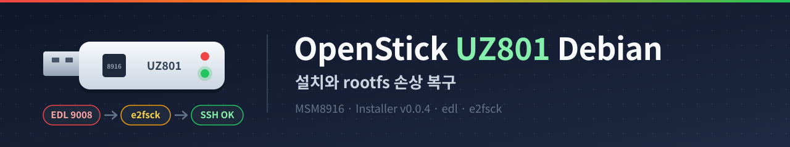

## OpenStick(UZ801) Debian 설치와 rootfs 손상 복구



저렴한 4G LTE USB 동글(UZ801)에 OpenStick Debian을 설치하고 사용을 해보았습니다.   
OpenStick Installer를 이용하면 설치 자체는 간단하지만, 저의 경우 설치가 완료되었다는 메시지가 출력된 이후에도 LED에 빨간불만 들어오고 USB 네트워크와 Wi-Fi가 모두 올라오지 않는 현상이 발생하였습니다.

원인을 확인해 보니 Installer v0.0.4 이미지의 rootfs가 손상되어 있었고, 이를 복구하는 과정에 대해 정리된 내용이 많지 않아 해당 포스팅을 작성하게 되었습니다.   
이번 포스팅에서는 OpenStick Installer로 Debian을 설치하는 과정과, 부팅되지 않는 rootfs를 EDL 모드에서 복구하는 방법에 대해 기록하도록 하겠습니다.

### OpenStick 란?

OpenStick은 Qualcomm MSM8916(Snapdragon 410) 기반의 4G LTE USB 동글에 Android 대신 Debian Linux를 설치하여, 작은 ARM64 Linux 장비로 사용할 수 있도록 해주는 커뮤니티 프로젝트입니다.   
UZ801, UFI003, UFI001C 등의 보드를 지원하며, 설치 후에는 USB 네트워크, Wi-Fi AP, 4G 모뎀을 Linux에서 그대로 사용할 수 있습니다.

### 테스트 환경

- 장비: UZ801 4G LTE USB 동글 (PCB 표기 `FY_UZ801_V3.31`, Qualcomm MSM8916, eMMC 4GB)
- 작업 호스트: Linux Mint 22.3 (Zena, Ubuntu 24.04 noble 기반)
- OpenStick Installer: v0.0.4
- edl (bkerler): V3.62
- 설치 후 OS: Debian GNU/Linux, Kernel 6.6.0-msm8916

### OpenStick Installer로 설치

OpenStick Installer는 stock 펌웨어 백업, IMEI 등 고유 파티션 보존, Debian 이미지 플래시를 한 번에 진행해 주는 도구입니다.   
stock 펌웨어 상태에서 ADB를 이용하므로, 먼저 동글의 Wi-Fi에 접속하여 `http://192.168.100.1/usbdebug.html`에서 USB debug를 활성화합니다.

아래와 같이 `run.sh`를 실행하면 가상 환경 구성과 의존성 설치가 자동으로 진행됩니다.

```
$ ./run.sh

============================================================
       OpenStick Installer - Automatic Setup
============================================================
[*] Preparing local virtual environment and installing dependencies...
[*] Installing required dependencies from requirements.txt...
...생략
[+] Core dependencies installed successfully.
[*] Switching execution into virtual environment (/home/chhanz/Downloads/test/openstick-installer/.venv/bin/python)...

   ___                   ____  _   _      _
  / _ \ _ __   ___ _ __ / ___|| |_(_) ___| | __
 | | | | '_ \ / _ \ '_ \\___ \| __| |/ __| |/ /
 | |_| | |_) |  __/ | | |___) | |_| | (__|   <
  \___/| .__/ \___|_| |_|____/ \__|_|\___|_|\_\
       |_|  MSM8916 Linux Installer v0.0.4
=====================================================
...생략
```

#### Step 1: 보드 선택

UZ801을 선택하면 보드 정보와 EDL 진입 방법 등 주의 사항이 출력됩니다.

```
[+] Step 1: Select your target board
-------------------------------------------------------
  [1] UZ801 (4G LTE USB Modem Dongle) - Qualcomm MSM8916
  [2] HMUF02 (4G LTE USB Modem Dongle) - Qualcomm MSM8916
  [3] HM-MIFIB (4G LTE Mobile Wi-Fi Router) - Qualcomm MSM8916
  [4] Other board
-------------------------------------------------------
Please select board [1-4] or 'q' to quit: 1

============================================================
 Selected Device: UZ801 (4G LTE USB Modem Dongle)
============================================================
  - SoC:              Qualcomm MSM8916 (Snapdragon 410)
  - RAM / Storage:    512MB / 1GB LPDDR3 / 4GB eMMC
  - Default Web UI:   http://192.168.100.1/usbdebug.html
  - Firehose Loader:  prog_emmc_firehose_8916.mbn

Important Notes:
  - To enable ADB: Connect to its Wi-Fi, open http://192.168.100.1/usbdebug.html in a browser, and toggle USB debug on.
  - Fastboot reboot command: fastboot oem reboot-edl transitions directly to EDL mode.
  - If soft-reboot to EDL fails: Hold physical recovery button or short EDL pins while plugging into USB.
  - Critical calibration partitions: modemst1, modemst2, fsg, fsc, persist, sec (contain unique IMEI and RF calibration).
============================================================
```

#### Step 2: stock 파티션 백업

백업을 선택하면 ADB로 IMEI를 확인한 후 `adb reboot edl`로 EDL 모드에 진입하여 eMMC 전체를 덤프합니다.   
저의 경우 약 9분 정도가 소요되었습니다.

```
[+] Step 2: Stock Partition Backup
============================================================
Backing up your stock eMMC partitions is STRONGLY RECOMMENDED.
Partitions like 'modemst1', 'modemst2', 'fsg', and 'fsc' contain your
stick's unique IMEI and cellular calibration data.
============================================================

Do you want to backup original partitions now? [Y/n]: y

[*] Initializing partition backup sequence...
[+] Found ADB device: 0123456789ABCDEF (State: device)
[*] Preparing root privileges on device...
[+] Detected modem IMEI: 861234567890123
[*] Attempting reboot to Qualcomm EDL mode (9008) via 'adb reboot edl'...
[*] Waiting for Qualcomm EDL 9008 device (timeout: 10s)...
.[+] Qualcomm 9008 EDL device detected!
[*] Target backup destination: backups/uz801_20261112_122236_861234567890123
[*] Modem IMEI associated with backup: 861234567890123
[*] Using Firehose programmer: prog_emmc_firehose_8916.mbn
[*] Dumping full raw eMMC to: full_emmc.bin (this takes ~8-10 minutes)...
      [\] EDL operation in progress... 01:29 elapsed
...생략
      [-] EDL operation in progress... 09:08 elapsed

[*] Automatically extracting calibration sidecars from raw eMMC dump...
[+] Unique device calibration files extracted to: /home/chhanz/Downloads/test/openstick-installer/calibration

*****************************************************************
                    BACKUP VERIFICATION SUMMARY
*****************************************************************
  - Backup Directory:   /home/chhanz/Downloads/test/openstick-installer/backups/uz801_20261112_122236_861234567890123
  - Modem IMEI:         861234567890123
  - Full eMMC Clone:    full_emmc.bin (3.64 GB)
  - Total Partitions:   27
  - Active Calibration: /home/chhanz/Downloads/test/openstick-installer/calibration

  Extracted Calibration Sidecars:
    [+] modemst1         :   1.50 MB
    [+] modemst2         :   1.50 MB
    [+] fsg              :   1.50 MB
    [+] fsc              :   1.00 KB
    [+] persist          :  32.00 MB
    [+] sec              :  16.00 KB

  [+] All unique cellular calibration partitions successfully backed up!
*****************************************************************

[+] Backup finished successfully!
```

위와 같이 IMEI와 RF calibration이 저장된 파티션(modemst1, modemst2, fsg, fsc, persist, sec)이 별도로 추출된 것을 확인 할 수 있습니다.   
stock 백업(`backups/.../full_emmc.bin`)은 문제가 생겼을 때 원복에 필요하므로 별도로 보관해 두는 것이 좋습니다.

#### Step 3: Debian 설치

`[1] Install Linux (Debian)`을 선택하면 GitHub Release에서 UZ801용 이미지를 내려받고, 백업한 calibration 파티션을 이미지에 주입한 후 EDL로 플래시합니다.

```
[+] Step 3: Choose Next Action
-----------------------------------------------------------------
  [1] Install Linux (Debian) [Recommended]
      Downloads universal Linux image for UZ801,
      injects your unique calibration partitions, and flashes via EDL.
  [2] Restore Stock Backup
      Flashes your original raw eMMC backup from backups/ to restore Android.
  [3] Create Sanitized Release Image (Dump from Stick & Clean)
      Dumps raw eMMC from device, extracts calibration to calibration/,
      cleans sensitive data, and packages dist/openstick-uz801-linux.zip.
  [4] Exit
-----------------------------------------------------------------
Please select action [1-4] or 'q' to quit: 1

=================================================================
       INSTALLING OPENSTICK LINUX (DEBIAN) FOR UZ801
=================================================================
...생략
[*] Fetching latest firmware releases from GitHub (Basistiy/openstick-installer)...
[+] Found release: 'v0.0.4'
[*] Downloading openstick-uz801-linux.zip from GitHub Release 'v0.0.4'...
[*] Downloading: 182.1 MB / 182.1 MB (100.0%)
[+] SHA-256 checksum verified successfully.
[*] Extracting openstick-uz801-linux.zip...

[+] Extracted firmware files to: .cache/releases/v0.0.4/openstick-uz801-linux
[+] Device is already in Qualcomm 9008 EDL mode.
[*] Injecting unique calibration files from /home/chhanz/Downloads/test/openstick-installer/calibration into full_emmc.bin...
[+] Successfully injected 7 partitions: fsc, fsg, modem, modemst1, modemst2, persist, sec

[*] Flashing raw eMMC image to stick: full_emmc.bin...
      [\] EDL operation in progress... 00:21 elapsed

[*] Flashing complete. Rebooting device (edl reset)...

[*] Waiting for stick to initialize Debian Linux (monitoring network & SSH)........

[!] Device is taking longer to initialize or USB Ethernet adapter is still connecting.

=================================================================
          CONGRATULATIONS! DEBIAN LINUX IS NOW INSTALLED
=================================================================
The stick is rebooting into Debian Linux. Please allow 30-45 seconds
for the first boot to initialize system services.

How to connect:
  1. USB Network Adapter (CDC-ECM / RNDIS) [Recommended]:
     - Stick IP: 192.168.5.1 (or 192.168.68.1)
     - SSH:      ssh user@192.168.5.1
     - Password: 1
     - Root:     sudo su (passwordless)

  2. Wi-Fi Access Point (if enabled):
     - SSID:     Openstick
     - Password: openstick
     - Stick IP: 192.168.4.1 (or 192.168.5.1)
     - SSH:      ssh user@192.168.4.1 (Password: 1)

  3. Test Hardware LEDs:
     - Command:  led-test (or 'led-test --help' for options)
=================================================================
```

위와 같이 설치가 완료되었다는 메시지와 함께 접속 정보가 출력됩니다.

### 설치 후 부팅이 되지 않는 현상

하지만 설치 완료 메시지와 달리, 실제로는 아래와 같은 상태였습니다.

- LED는 빨간불만 계속 켜져 있음
- 호스트에 USB 네트워크 인터페이스가 생성되지 않음
- `Openstick` Wi-Fi SSID도 보이지 않음

`Device is taking longer to initialize` 메시지는 Installer가 플래시 후 60초 동안 SSH 응답을 기다리다가 응답이 없으면 출력하는 메시지이며, 응답이 없어도 CONGRATULATIONS가 출력됩니다.

확인해 보니 이미 아래 이슈로 보고된 내용이었습니다.   
v0.0.4의 `openstick-uz801-linux.zip`에 포함된 rootfs가 손상되어 있어 부팅이 되지 않으며, 장비가 벽돌이 된 것은 아니고 rootfs만 복구하면 정상 부팅이 됩니다.

- Basistiy/openstick-installer Issue #2: v0.0.4 uz801 image has corrupt ext4 rootfs

### EDL 모드 진입

rootfs가 손상된 상태에서도 부트로더(lk2nd)는 정상이므로, 장비를 다시 연결하면 아래와 같이 fastboot 모드로 인식이 됩니다.

```
$ lsusb
...생략
Bus 002 Device 013: ID 18d1:d00d Google Inc. Xiaomi Mi/Redmi 2 (fastboot)
```

`18d1:d00d`는 fastboot 장치이며, 이름은 USB ID 데이터베이스의 표기일 뿐입니다.   
아래 명령어를 통해 fastboot에서 바로 Qualcomm EDL(9008) 모드로 전환이 가능합니다.

```
$ sudo fastboot oem reboot-edl
OKAY [  0.002s]
Finished. Total time: 0.002s

$ lsusb
...생략
Bus 002 Device 014: ID 05c6:9008 Qualcomm, Inc. Gobi Wireless Modem (QDL mode)
```

위와 같이 `05c6:9008`로 EDL 모드에 진입한 것을 확인 할 수 있습니다.

참고로 fastboot로도 인식되지 않는 경우에는, USB 단자의 D+와 GND를 쇼트한 상태로 연결하여 EDL 모드로 진입하는 방법이 알려져 있습니다.

### edl 설치

EDL 모드에서 파티션을 읽고 쓰기 위해 bkerler의 edl을 설치합니다.   
ModemManager가 9008 포트를 점유할 수 있으므로 먼저 중지합니다.

```
$ sudo apt install -y adb fastboot python3-dev python3-pip python3-venv liblzma-dev git e2fsprogs
$ sudo systemctl stop ModemManager

$ git clone https://github.com/bkerler/edl.git
$ cd edl
$ git submodule update --init --recursive
$ sudo bash ./install-linux-edl-drivers.sh
$ python3 -m venv venv
$ ./venv/bin/pip install .
```

자동으로 맞는 loader를 찾지 못하는 경우가 있어, OpenStick Installer 레포에 포함된 Firehose loader를 함께 받아 둡니다.

```
$ wget -O prog_emmc_firehose_8916.mbn \
  https://raw.githubusercontent.com/Basistiy/openstick-installer/main/loaders/prog_emmc_firehose_8916.mbn
```

아래와 같이 GPT를 확인합니다.

```
$ sudo ./venv/bin/edl --loader=prog_emmc_firehose_8916.mbn printgpt
...생략
GPT Table:
-------------
fsc:                 Offset 0x0000000000200000, Length 0x0000000000000400, ...
fsg:                 Offset 0x0000000000200400, Length 0x0000000000180000, ...
modem:               Offset 0x0000000000380400, Length 0x0000000004000000, ...
...생략
boot:                Offset 0x0000000006a04400, Length 0x0000000004000000, ...
rootfs:              Offset 0x000000000aa04400, Length 0x00000000de5f7a00, ...

Total disk size:0x00000000e9000000, sectors:0x0000000000748000
```

위와 같이 `rootfs` 파티션의 위치(`0xAA04400`)와 크기(`0xDE5F7A00`)를 확인 할 수 있습니다.   
전체 섹터 수(`0x748000` = 7,634,944)가 이미지 크기와 같은 것도 함께 확인합니다. 일부 UZ801은 eMMC가 이미지보다 작아 쓰기 자체가 실패하는 경우가 있다고 합니다.

### rootfs 추출 및 복구

처음에는 장비에서 rootfs를 직접 읽어 왔는데, USB 연결 상태에 따라 아래와 같이 중간에 끊기는 경우가 있었습니다.

```
$ sudo ./venv/bin/edl r rootfs rootfs.bin
...생략
Progress: |█---------|  11.2% Read (Sector 0xC65C8 of 0x6F2FBD, 10m:10s left) 5.16 MB/s
DeviceClass - USBError(5, 'Input/Output Error')
```

rootfs는 장비별 고유 정보가 들어가지 않는 영역이므로, 장비에서 읽어 오지 않고 Installer가 내려받은 이미지에서 바로 추출하는 것이 빠르고 안전합니다.   
이미지 위치와 파티션 구성은 아래와 같습니다.

```
$ fdisk -l ./.cache/releases/v0.0.4/openstick-uz801-linux/full_emmc.bin
GPT PMBR size mismatch (350241 != 7634943) will be corrected by write.
Disk ./.cache/releases/v0.0.4/openstick-uz801-linux/full_emmc.bin: 3.64 GiB, 3909091328 bytes, 7634944 sectors
...생략
Device                                                          Start     End Sectors  Size Type
...생략
./.cache/releases/v0.0.4/openstick-uz801-linux/full_emmc.bin13 217122  348193  131072   64M unknown
./.cache/releases/v0.0.4/openstick-uz801-linux/full_emmc.bin14 348194 7634910 7286717  3.5G unknown
```

14번 파티션의 시작 섹터(348194)와 크기(7286717 섹터)가 장비의 `rootfs`와 동일합니다.   
아래와 같이 `dd`로 rootfs만 잘라냅니다. (348194 x 512 = 178275328, 7286717 x 512 = 3730799104)

```
$ IMG=~/Downloads/test/openstick-installer/.cache/releases/v0.0.4/openstick-uz801-linux/full_emmc.bin
$ dd if="$IMG" of=rootfs.bin bs=4M iflag=skip_bytes,count_bytes \
   skip=178275328 count=3730799104 status=progress
3730799104 bytes (3.7 GB, 3.5 GiB) copied, 33.1802 s, 112 MB/s

$ cp rootfs.bin rootfs_orig.bin
```

다음과 같이 `e2fsck`로 파일시스템을 복구합니다.   
첫 번째 실행은 아래와 같이 오류로 종료되지만, 이 과정에서 journal 복구가 진행됩니다.

```
$ sudo e2fsck -fy rootfs.bin
e2fsck 1.47.0 (5-Feb-2023)
ext2fs_check_desc: Corrupt group descriptor: bad block for block bitmap
e2fsck: Group descriptors look bad... trying backup blocks...
rootfs.bin: recovering journal
e2fsck: unable to set superblock flags on rootfs.bin

rootfs.bin: ***** FILE SYSTEM WAS MODIFIED *****

rootfs.bin: ********** WARNING: Filesystem still has errors **********
```

한 번 더 실행하면 남은 오류가 정리됩니다.

```
$ sudo e2fsck -fy rootfs.bin
e2fsck 1.47.0 (5-Feb-2023)
Pass 1: Checking inodes, blocks, and sizes
Inode 12321 has an invalid extent node (blk 33288, lblk 0)
Clear? yes
...생략
Pass 4: Checking reference counts
Unattached inode 12321
Connect to /lost+found? yes
...생략
Pass 5: Checking group summary information
Block bitmap differences:  +(20692--22738) -126976 -127490 ...생략
Fix? yes
...생략

rootfs.bin: ***** FILE SYSTEM WAS MODIFIED *****
rootfs.bin: 12370/229376 files (0.1% non-contiguous), 133031/910839 blocks
```

마지막으로 `-n` 옵션으로 오류가 남아 있지 않은지 확인합니다.

```
$ sudo e2fsck -fn rootfs.bin
e2fsck 1.47.0 (5-Feb-2023)
Pass 1: Checking inodes, blocks, and sizes
Pass 2: Checking directory structure
Pass 3: Checking directory connectivity
Pass 4: Checking reference counts
Pass 5: Checking group summary information
rootfs.bin: 12370/229376 files (0.1% non-contiguous), 133031/910839 blocks
```

위와 같이 Pass 1~5가 오류 없이 완료된 것을 확인 할 수 있습니다.   
`/lost+found`로 옮겨진 파일은 아래와 같이 확인이 가능하며, 저의 경우 대부분 8MiB 크기의 systemd journal 파일이었습니다.

```
$ sudo debugfs -R 'ls -l /lost+found' rootfs.bin
12321  100640 (1)      0    999   8388608 21-Oct-2026 05:35 #12321
12341  100640 (1)      0    999   8388608 21-Oct-2026 05:39 #12341
12346  100640 (1)      0    999   8388608 21-Oct-2026 05:35 #12346
12359  100600 (1)   1000   1000     102 14-Apr-2026 14:51 #12359
12361  100600 (1)      0      0     102 14-Apr-2026 14:51 #12361
12362  100644 (1)      0      0    8192 14-Apr-2026 15:07 #12362
12366  100640 (1)      0    999   8388608 21-Oct-2026 05:39 #12366
...생략
```

### rootfs 재기록

장비를 EDL 모드로 진입시킨 후, 복구한 `rootfs.bin`을 `rootfs` 파티션에만 기록합니다.   
IMEI 등이 저장된 파티션(modemst1, modemst2, fsg 등)은 건드리지 않습니다.

```
$ sudo ./venv/bin/edl --loader=prog_emmc_firehose_8916.mbn w rootfs rootfs.bin
...생략
main - Trying to connect to firehose loader ...
firehose - TargetName=MSM8916
firehose - MemoryName=eMMC
...생략
Writing to physical partition 0, sector 348194, sectors 7286717
Progress: |██████████| 100.0% Write (Sector 0x6F2FBD of 0x6F2FBD, ) 6.53 MB/s
Wrote rootfs.bin to sector 348194.

$ sudo ./venv/bin/edl --loader=prog_emmc_firehose_8916.mbn reset
...생략
DeviceClass - USBError(19, 'No such device (it may have been disconnected)')
```

`reset` 이후의 `USBError(19)`는 장비가 재부팅되면서 USB 연결이 끊어져 출력되는 메시지이므로 무시해도 됩니다.

### 결과 확인

잠시 후 호스트에서 아래와 같이 USB Gadget 장치가 인식되고, USB 네트워크 인터페이스에 IP가 할당됩니다.

```
$ lsusb
...생략
Bus 002 Device 015: ID 1d6b:0104 Linux Foundation Multifunction Composite Gadget

$ ip a
...생략
14: enx2a85da41ebf9: <BROADCAST,MULTICAST,UP,LOWER_UP> mtu 1500 qdisc fq_codel state UP group default qlen 1000
    inet 192.168.5.242/24 brd 192.168.5.255 scope global dynamic noprefixroute enx2a85da41ebf9
```

기본 계정(`user` / `1`)으로 SSH 접속을 해보았습니다.

```
$ ssh user@192.168.5.1
user@192.168.5.1's password:
Linux openstick-debian 6.6.0-msm8916 #6 SMP PREEMPT Thu May 30 14:30:02 UTC 2024 aarch64
...생략
user@openstick-debian:~$ df
Filesystem      1K-blocks   Used Available Use% Mounted on
/dev/root         3546844 452004   2917000  14% /
...생략
```

위와 같이 Debian으로 정상 부팅되고 SSH 접속이 되는 것을 확인 할 수 있습니다.   
기본 계정의 비밀번호는 `1`이므로, 접속 후에는 비밀번호를 변경하거나 새 계정을 생성하여 사용하는 것을 권장합니다.

위와 같은 방법으로 OpenStick Installer v0.0.4 설치 후 부팅되지 않는 UZ801을 rootfs만 복구하여 정상적으로 사용하는 것이 가능합니다.

### 참고

- OpenStick Installer: [https://github.com/Basistiy/openstick-installer](https://github.com/Basistiy/openstick-installer)
- OpenStick Installer Issue #2 (v0.0.4 rootfs 손상): [https://github.com/Basistiy/openstick-installer/issues/2](https://github.com/Basistiy/openstick-installer/issues/2)
- bkerler/edl: [https://github.com/bkerler/edl](https://github.com/bkerler/edl)
- OpenStick 커뮤니티 문서: [https://openstick.org/](https://openstick.org/)
- UZ801 EDL 및 하드웨어 정보: [https://github.com/AlienWolfX/UZ801-USB-MODEM](https://github.com/AlienWolfX/UZ801-USB-MODEM)
